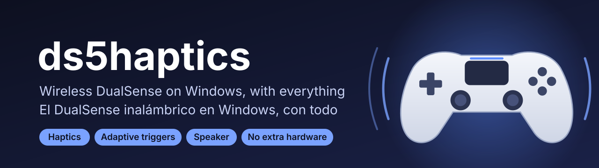

<p align="center">
  
</p>

<p align="center">
  <a href="../../releases/latest"></a>
  
  <a href="LICENSE"></a>
</p>

<p align="center">
  <b>English</b> · <a href="#espanol">Español</a>
</p>

# ds5haptics

**Use the PS5 DualSense over Bluetooth on Windows as if it were plugged in:** haptics, adaptive
triggers, the controller speaker, lights and everything else, with your PC's regular Bluetooth
adapter. No cables, no Raspberry Pi, no extra hardware.

Over Bluetooth, Windows and PC games only get the basics from the DualSense: on PC, fine haptics
and the speaker only work over a cable. ds5haptics creates a **virtual "wired" DualSense** in
Windows and forwards everything the game sends to the real controller over Bluetooth.

## Features

| | |
|---|---|
| 🎮 **Native haptics** | The fine vibration games send as audio reaches the controller, with minimal latency. |
| 🎯 **Adaptive triggers** | L2/R2 resistance and effects, as the game designed them. |
| 🔊 **Controller speaker** | The controller speaker sound, compressed and sent over Bluetooth. |
| 🕹️ **PS4 and Xbox modes** | For games without DualSense support: the controller shows up as a DualShock 4 or an Xbox 360 controller. Detected automatically. |
| 📋 **Per-game profiles** | Speaker volume, haptics intensity and mode per game, applied automatically. |
| 🔋 **Low battery warning** | At 15% or less, the mic button light pulses. |
| 📊 **On-screen stats** | Tray icon and a translucent panel with **Alt+Insert**: battery, mode, haptics, triggers, speaker and latency. |
| 🚀 **Starts with Windows** | Runs in the background and connects by itself when you turn the controller on. |
| 🌐 **English and Spanish** | Follows the Windows language. |

## Requirements

- Windows 10 (1803 or later) or 11, 64-bit.
- A DualSense paired over Bluetooth (the PC's regular Bluetooth adapter is enough).
- Two free, open-source programs the installer downloads for you:
  [usbip-win2](https://github.com/vadimgrn/usbip-win2) (creates the virtual controller, signed drivers)
  and [HidHide](https://github.com/nefarius/HidHide) (hides the real controller so games don't see two).

## Install

1. Pair the DualSense in *Settings > Bluetooth & devices* and leave it on.
2. Download the latest zip from **[Releases](../../releases/latest)** and unzip it.
3. Double-click **`instalar.bat`** (asks for administrator rights). It downloads and installs
   usbip-win2 and HidHide, sets everything up and enables start with Windows.
4. Restart the PC. Done: the controller icon shows up next to the clock.

> Windows may show "Windows protected your PC" because the program has no paid code signature.
> Click *More info > Run anyway*. The source code is right here for anyone to review.

## Usage

- **Tray icon:** left click or **Alt+Insert** shows the stats. Right click: *Show stats*,
  *Start with Windows* and *Exit*.
- **Profiles:** `C:\ds5haptics\perfiles.bat` opens `ds5haptics.ini`:
  ```ini
  [gamename]            ; part of the game's .exe name
  speaker = 3           ; extra controller speaker volume
  mode = xbox           ; ps5 / ps4 / xbox
  ```
  Changes apply on save, no restart needed.
- **Games without DualSense support** are detected automatically and switched to Xbox mode
  (the first time, the game may need a restart). When the game closes, PS5 mode comes back.
- **Log:** `C:\ds5haptics\ds5haptics.log` shows what's going on.

## FAQ

- **Steam Input:** if a game with DualSense support gives you no haptics or triggers, try turning
  Steam Input off for it: Steam may be translating the controller.
- **Anti-cheat:** some online games may not trust virtual controllers. Please report it in *Issues*.
- **Firmware updates:** use Sony's app with a cable while ds5haptics is stopped (tray icon > *Exit*).
  Bluetooth haptics use an undocumented format that an update could change.
- **Uninstall:** run `C:\ds5haptics\desinstalar.bat`, then uninstall *USBip* and *HidHide*.

## For developers

Written in C++17 with no dependencies beyond the Windows API and libopus (downloaded at build time).
`build.bat` builds with Visual Studio Build Tools and CMake. Tests run on Linux
(`cmake -S . -B build && cmake --build build`, plus the scripts in `tests/`) and include a simulated
USB/IP client that enumerates the virtual controllers the way Windows does.
Technical notes (in Spanish): [docs/guia-tecnica.md](docs/guia-tecnica.md).

## How it was made

ds5haptics was developed with the help of **Claude**, Anthropic's AI assistant: the code, tests
and documentation were written together, and every feature was tested on a real PC with the
controller and real games before release.

## Credits and license

Built on the research of others, especially [SAxense](https://github.com/egormanga/SAxense)
and [DS5Dongle](https://github.com/awalol/DS5Dongle). Full list in [CREDITS.md](CREDITS.md).

Licensed under [MPL-2.0](LICENSE). Independent project, not affiliated with or endorsed by Sony
Interactive Entertainment or Microsoft. PlayStation, DualSense and DualShock are trademarks of
Sony Interactive Entertainment; Xbox is a trademark of Microsoft.

---

<a name="espanol"></a>

# ds5haptics (Español)

**Usá el DualSense de PS5 por Bluetooth en Windows como si estuviera conectado por cable:**
háptica, gatillos adaptativos, parlante del mando, luces y todo lo demás, con el adaptador
Bluetooth común de la PC. Sin cables, sin Raspberry Pi ni hardware extra.

Por Bluetooth, Windows y los juegos de PC solo reciben del DualSense lo básico: la háptica fina
y el parlante, en PC, solo funcionan por cable. ds5haptics crea en Windows un **DualSense
"por cable" virtual**, y todo lo que el juego le manda lo reenvía al mando real por Bluetooth.

## Qué hace

| | |
|---|---|
| 🎮 **Háptica nativa** | La vibración fina que el juego manda por audio llega al mando, con latencia mínima. |
| 🎯 **Gatillos adaptativos** | Resistencia y efectos en L2 y R2, tal como los diseñó el juego. |
| 🔊 **Parlante del mando** | El sonido del parlante del mando, comprimido y enviado por Bluetooth. |
| 🕹️ **Modo PS4 y Xbox** | Para juegos sin soporte de DualSense: el mando se presenta como DualShock 4 o como mando de Xbox 360. Se detecta solo. |
| 📋 **Perfiles por juego** | Volumen del parlante, intensidad de la háptica y modo, por juego. Se aplican solos. |
| 🔋 **Aviso de batería baja** | Con 15% o menos, la luz del botón de micrófono parpadea. |
| 📊 **Estadísticas en pantalla** | Ícono en la bandeja y un cuadro semitransparente con **Alt+Insert**: batería, modo, háptica, gatillos, parlante y latencia. |
| 🚀 **Arranca con Windows** | Corre en segundo plano y se conecta solo cuando prendés el mando. |
| 🌐 **Español e inglés** | Según el idioma de Windows. |

## Qué hace falta

- Windows 10 (1803 o posterior) u 11, de 64 bits.
- Un DualSense emparejado por Bluetooth (el adaptador Bluetooth común de la PC alcanza).
- Dos programas gratuitos y de código abierto que el instalador baja solo:
  [usbip-win2](https://github.com/vadimgrn/usbip-win2) (crea el mando virtual, con drivers firmados)
  y [HidHide](https://github.com/nefarius/HidHide) (oculta el mando real para que los juegos no vean dos).

## Instalación

1. Emparejá el DualSense por Bluetooth en *Configuración > Bluetooth y dispositivos* y dejalo prendido.
2. Bajá el zip de la última versión en **[Releases](../../releases/latest)** y descomprimilo.
3. Hacé doble clic en **`instalar.bat`** (pide permisos de administrador). Baja e instala
   usbip-win2 y HidHide, configura todo y activa el inicio con Windows.
4. Reiniciá la PC. Listo: aparece el ícono del mando junto al reloj.

> Windows puede mostrar "Windows protegió su PC" porque el programa no tiene firma digital paga.
> Tocá *Más información > Ejecutar de todas formas*. El código está acá para que cualquiera lo revise.

## Uso

- **Ícono en la bandeja:** clic izquierdo o **Alt+Insert** muestra las estadísticas. Clic derecho:
  *Ver estadísticas*, *Iniciar con Windows* y *Salir*.
- **Perfiles:** `C:\ds5haptics\perfiles.bat` abre `ds5haptics.ini`. Ejemplo:
  ```ini
  [nombredeljuego]      ; parte del nombre del .exe
  parlante = 3          ; volumen extra del parlante del mando
  modo = xbox           ; ps5 / ps4 / xbox
  ```
  Los cambios se aplican al guardar, sin reiniciar nada.
- **Juegos sin soporte de DualSense:** el programa lo detecta solo y pasa a modo Xbox
  (la primera vez puede hacer falta reiniciar el juego). Al cerrar el juego vuelve a modo PS5.
- **Registro:** `C:\ds5haptics\ds5haptics.log` muestra todo lo que pasa: qué juego detectó,
  qué perfil aplicó, la batería y los errores.

## Preguntas frecuentes

<details>
<summary><b>¿Funciona con todos los juegos?</b></summary>

Con los que admiten el DualSense en PC, funciona todo lo que el juego use. Los demás funcionan
en modo Xbox (botones, sticks y vibración clásica). Algunos juegos online con antitrampas pueden
desconfiar de los mandos virtuales; si te pasa, contalo en *Issues*.
</details>

<details>
<summary><b>¿Hay que desactivar Steam Input?</b></summary>

Si en un juego con soporte de DualSense no sentís la háptica o los gatillos, probá desactivarlo:
con Steam Input activo, Steam puede traducir el mando y el juego no recibe esos efectos. Se cambia
en *Propiedades del juego > Controlador*.
</details>

<details>
<summary><b>¿Tiene latencia?</b></summary>

ds5haptics agrega unos pocos milisegundos (se ve en el cuadro de estadísticas). El resto depende
del juego, del audio de Windows y del Bluetooth.
</details>

<details>
<summary><b>¿Puedo actualizar el firmware del mando?</b></summary>

Sí, con la app oficial de Sony y el mando por cable, con ds5haptics detenido (clic derecho en el
ícono > *Salir*). La háptica por Bluetooth usa un formato no documentado: si una actualización lo
cambia, puede dejar de andar hasta que se adapte el programa.
</details>

<details>
<summary><b>¿Cómo lo desinstalo?</b></summary>

Ejecutá `C:\ds5haptics\desinstalar.bat`, y desinstalá *USBip* y *HidHide* desde
*Configuración > Aplicaciones*.
</details>

## Para desarrolladores

Está escrito en C++17, sin dependencias además de la API de Windows y libopus (que se descarga
al compilar). `build.bat` compila con Visual Studio Build Tools y CMake. Los tests corren en Linux
(`cmake -S . -B build && cmake --build build`, más los scripts de `tests/`) e incluyen un cliente
USB/IP simulado que enumera los mandos virtuales como lo haría Windows.
Detalles técnicos y de cada fase: [docs/guia-tecnica.md](docs/guia-tecnica.md).

## Cómo se hizo

ds5haptics se desarrolló con la ayuda de **Claude**, el asistente de IA de Anthropic: el código,
los tests y la documentación se escribieron en conjunto, y cada función se probó en una PC real
con el mando y juegos reales antes de publicarse.

## Créditos y licencia

Este proyecto existe gracias a la investigación de otras personas, en especial
[SAxense](https://github.com/egormanga/SAxense) (formato de la háptica por Bluetooth) y
[DS5Dongle](https://github.com/awalol/DS5Dongle) (parlante y mando virtual). Lista completa en
[CREDITS.md](CREDITS.md).

Código bajo licencia [MPL-2.0](LICENSE). Proyecto independiente, sin relación con Sony
Interactive Entertainment ni con Microsoft. PlayStation, DualSense y DualShock son marcas de Sony
Interactive Entertainment; Xbox es marca de Microsoft.
